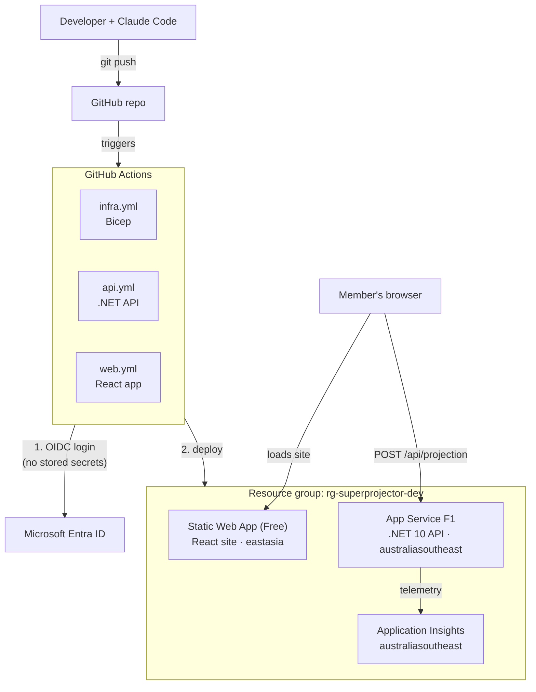

# Super Projector

**Live demo:** https://yellow-glacier-0b58d1c00.3.azurestaticapps.net
_(free tier: the first request may take ~20 seconds while the API wakes up)_

A small learning project that projects a superannuation balance at age 67.
A member enters their age, current balance, salary and contribution rate; a .NET API
calculates the projected balance and a React web app displays it.

## Architecture



| Part | Folder | Technology | Hosting |
| --- | --- | --- | --- |
| API | `api/` | .NET 10 C# minimal API | Azure App Service |
| Web app | `web/` | React + TypeScript (Vite) | Azure Static Web Apps |
| Infrastructure | `infra/` | Bicep | Azure |
| CI/CD | `.github/workflows/` | GitHub Actions, logging in to Azure with OIDC (no stored secrets) | GitHub |
| Mobile | `mobile/` | Reserved for a future mobile client | — |

## Key decisions

| Decision | Why |
| --- | --- |
| .NET 10 LTS, not .NET 11 STS | LTS is the stable baseline: a year of patches and mature library and hosting support. Both are supported until Nov 2028 (STS is now 24 months), so we move to .NET 12 LTS rather than step through 11. |
| OIDC login, not stored secrets | No long-lived Azure credential to leak or rotate. GitHub's short-lived token is trusted only for `main` of this exact repo (by immutable ID). |
| Bicep + what-if | Infrastructure is code, so it's reviewable and repeatable. What-if previews every change and runs Azure's preflight checks (it caught the F1 quota issue before anything was deployed). |
| Assumptions in config | Return, wage growth, tax and retirement age live in `appsettings.json`, so each environment can change them without a code change. The API echoes them back with every result. |
| Disclaimer returned by the API | One source of truth: every client (web now, mobile later) shows the same wording. |
| Melbourne region | The subscription has 0 F1 App Service quota in australiaeast; australiasoutheast still keeps data onshore. |
| Pinned SDK and runners | `global.json` and `ubuntu-24.04` make local and CI builds use the same toolchain. Upgrades are deliberate, not surprises. |

## Prerequisites

- [Homebrew](https://brew.sh/)
- [Git](https://git-scm.com/)
- [Node.js](https://nodejs.org/) (LTS)
- [.NET 10 SDK](https://dotnet.microsoft.com/download) (version pinned in `global.json`)
- [Azure CLI](https://learn.microsoft.com/cli/azure/install-azure-cli)
- [GitHub CLI](https://cli.github.com/)
- [Visual Studio Code](https://code.visualstudio.com/)
- [Claude Code](https://claude.com/claude-code)

## Getting started

_To be written once the API and web app have been scaffolded._

## Web app

The React app in `web/` calls the API, so start both, each in its own terminal:

```sh
# Terminal 1: the API, on http://localhost:5080
cd api
dotnet run --project src/SuperProjector.Api

# Terminal 2: the web app, on http://localhost:5173
cd web
npm install   # first time only
npm run dev
```

Then open http://localhost:5173.

Other commands, run from `web/`: `npm run test` (Vitest), `npm run lint`
(oxlint) and `npm run build` (type-check and build into `web/dist/`).

### `VITE_API_BASE_URL`

The base URL of the API, without a trailing slash. Locally it is set to
`http://localhost:5080` in `web/.env.development`, which is committed because it
holds no secrets. To use a different value on your machine, copy
`web/.env.example` to `web/.env.local` (git-ignored) and change it there.

Vite builds this value into the JavaScript bundle when you run `npm run build`,
so it must be set to the deployed API's URL at build time, and it is visible
to anyone using the site. Never put secrets in a `VITE_` variable.

The API only accepts browser requests from the origins listed in its
`Cors:AllowedOrigins` setting, so the web app's URL must be listed there too.

## Infrastructure

All Azure resources are defined in Bicep in `infra/`; never change them by
hand in the portal.

- `infra/main.bicep`: the template. It creates a Log Analytics workspace,
  workspace-based Application Insights, a Free-tier Static Web App (web), a
  Linux App Service Plan and a Web App running .NET 10 (API). Every resource is
  tagged `project=super-projector`, `env=<environment>`, `managedBy=bicep`.
- `infra/main.bicepparam`: parameter values for the `dev` environment.

Resource names end in a short suffix generated from the resource group ID, so
they are unique across Azure and stay the same on every deployment.

The resource group `rg-superprojector-dev` (australiaeast) must already exist.
From the repo root, check and preview the template:

```sh
az bicep build --file infra/main.bicep        # compile and check for errors
az deployment group what-if \
  --resource-group rg-superprojector-dev \
  --parameters infra/main.bicepparam          # preview changes; deploys nothing
```

Useful parameters (override with `--parameters name=value`):

| Parameter | Default | Notes |
| --- | --- | --- |
| `location` | resource group's region | Region for the API and monitoring. |
| `appServiceSkuName` | `F1` (free) | Use `B1` if F1 is unavailable. |
| `staticWebAppLocation` | `eastasia` | Static Web Apps only run in a few regions; content is still served globally. |

### Known constraints

- **API and monitoring are in australiasoutheast (Melbourne), not
  australiaeast.** Our new subscription has 0 F1 App Service quota in
  australiaeast, so deployments fail there with `SubscriptionIsOverQuotaForSku`.
  `main.bicepparam` sets `location = 'australiasoutheast'` for dev, which still
  keeps data onshore in Australia. The resource group itself stays in
  australiaeast; that only affects where its metadata is stored.
- **The Static Web App is in eastasia.** Static Web Apps supports only a few
  regions, none of them in Australia. Its content is still served from a
  global CDN, and it hosts static files only (HTML, JavaScript, CSS) with no
  member data. Member inputs go straight from the browser to the API in
  Australia.

## CI/CD

Pipelines live in `.github/workflows/` and run on GitHub Actions. They log in to
Azure with **OIDC**: GitHub issues a short-lived token that Azure trusts through
a federated credential on an Entra ID app registration. No Azure passwords or
keys are stored in GitHub.

### Infrastructure pipeline (`infra.yml`)

Runs when changes to `infra/**` or the workflow file are pushed to `main`, or
manually from the Actions tab (**Run workflow**, on `main`).

1. **validate**: compiles `infra/main.bicep` and runs a what-if preview,
   which also runs Azure's preflight checks such as quota.
2. **deploy** (only if validate passes): runs `az deployment group create`
   against `rg-superprojector-dev`, then lists the API and web URLs and app
   names in the run's summary.

### API pipeline (`api.yml`)

Runs when changes to `api/**`, `global.json` or the workflow file are pushed to
`main`, or manually.

1. **build-test**: installs the .NET SDK from `global.json`, then restores,
   builds (Release) and runs all unit and integration tests. It then publishes
   the app and saves it as a build artifact.
2. **deploy** (only if every test passes): deploys that exact artifact to the
   Web App with `azure/webapps-deploy`. Then it smoke tests the live app:
   `/health` must report `Healthy` within about 2 minutes (F1 apps sleep when
   idle, so the first request is slow), and a sample `POST /api/projection`
   must return a `projectedBalance`.

### Web pipeline (`web.yml`)

Runs when changes to `web/**` or the workflow file are pushed to `main`, or
manually. One job:

1. Installs Node 26 (LTS) and dependencies with `npm ci`, then runs lint and tests.
2. Logs in to Azure and looks up the API's hostname, the Static Web App's
   name and its deployment token. The token is masked so it never appears in
   logs.
3. Builds with `VITE_API_BASE_URL` set to the deployed API, then uploads
   `web/dist` with `Azure/static-web-apps-deploy` (`skip_app_build: true`, so
   it deploys the build that was just tested rather than rebuilding).
4. Checks the site returns HTTP 200.

`web/public/staticwebapp.config.json` is copied into the build. It serves
`index.html` for unknown paths and adds basic security headers.

### Shared conventions

- Each pipeline lists its URL(s) on the run's **Summary** page.
- Each has its own concurrency group (`infra-dev`, `api-dev`, `web-dev`): only
  one run of a pipeline happens at a time, and a new run waits rather than
  cancelling one in progress.
- Runners are pinned to `ubuntu-24.04` rather than `ubuntu-latest`, so a GitHub
  image upgrade can't change the build unexpectedly.
- Resource names have generated suffixes, so the API and web pipelines look
  them up with `az` rather than hard-coding them. Run the infra pipeline first.

**Repository secrets required** (these are IDs, not passwords):

| Secret | Value |
| --- | --- |
| `AZURE_CLIENT_ID` | Application (client) ID of the Entra ID app registration |
| `AZURE_TENANT_ID` | Directory (tenant) ID |
| `AZURE_SUBSCRIPTION_ID` | Azure subscription ID |

**Federated credential subject.** Azure only accepts a GitHub token whose
subject exactly matches the federated credential. GitHub's subject includes
the immutable numeric IDs of the owner and repo:

```text
repo:<owner>@<owner-id>/<repo>@<repo-id>:ref:refs/heads/main
```

For this repo that is:

```text
repo:contact2kuldeep@15072567/super-projector@1450214291:ref:refs/heads/main
```

The IDs protect against a repo being renamed, or deleted and recreated with
the same name: the new repo gets a different ID, so it can't reuse our Azure
access. If login fails with `AADSTS700213`, the error message shows the exact
subject GitHub sent; copy it into the federated credential.

The jobs deliberately have no GitHub `environment:`. Adding one changes the
subject's ending to `:environment:<name>`, which breaks login unless a
matching federated credential is added first. The identity also needs a role
on the resource group that can create resources (e.g. Contributor).

## Backlog

1. **Show results in today's dollars** _(priority)_: a balance 27 years away
   overstates its buying power. Discount by an inflation assumption so members
   see what it's worth now.
2. **Environments with approval gates**: separate test and prod, with a manual
   approval before prod (needs a federated credential per GitHub environment).
3. **Azure Front Door + WAF**: one entry point with a web application firewall
   in front of the site and API.
4. **Azure API Management**: rate limiting, API keys and versioning once there
   are several clients.
5. **Member authentication**: sign-in (e.g. Entra External ID) before the app
   handles any real member data.
6. **Application Insights alerts**: notify on failed health checks, error-rate
   spikes and slow responses.
7. **Azure Key Vault**: a home for secrets when the app first needs one.
8. **Security scanning in CI**: dependency, secret and code scanning (e.g.
   Dependabot, CodeQL) on every push.
9. **React Native app**: a mobile client in `mobile/` using the same API.
