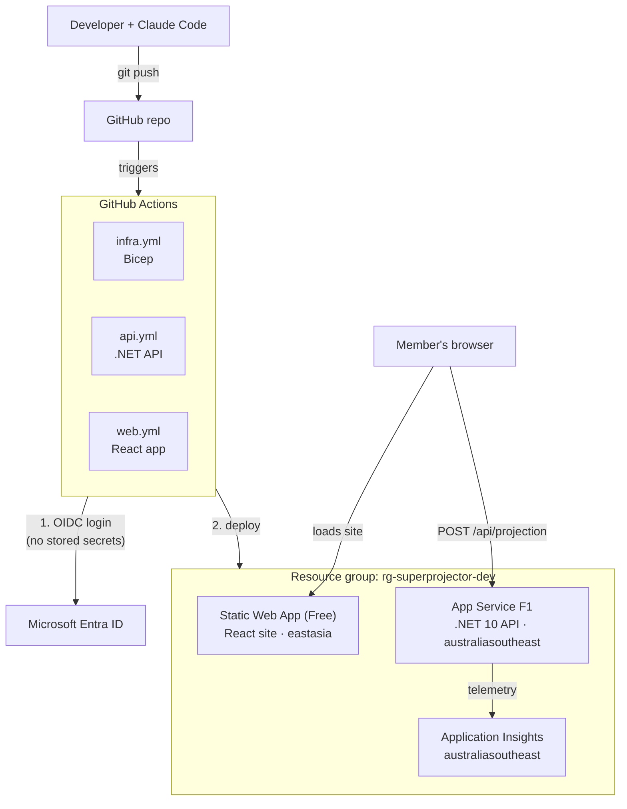

# Super Projector

**Live demo:** https://yellow-glacier-0b58d1c00.3.azurestaticapps.net
_(free tier: the first request may take ~20 seconds while the API wakes up)_

A small learning project that projects a superannuation balance at age 67.
A member enters their age, current balance, salary and contribution rate; a .NET API
calculates the projected balance and a React web app displays it.

## Architecture

| Part | Folder | Technology | Hosting |
| --- | --- | --- | --- |
| API | `api/` | .NET 10 C# minimal API | Azure App Service |
| Web app | `web/` | React + TypeScript (Vite) | Azure Static Web Apps |
| Infrastructure | `infra/` | Bicep | Azure |
| CI/CD | `.github/workflows/` | GitHub Actions, logging in to Azure with OIDC (no stored secrets) | GitHub |
| Mobile | `mobile/` | Reserved for a future mobile client | — |

## Key decisions

| Decision | Why |
| --- | --- |
| .NET 10 LTS, not .NET 11 STS | LTS is the stable baseline: a year of patches and mature library and hosting support. Both are supported until Nov 2028 (STS is now 24 months), so we move to .NET 12 LTS rather than step through 11. |
| OIDC login, not stored secrets | No long-lived Azure credential to leak or rotate. GitHub's short-lived token is trusted only for `main` of this exact repo (by immutable ID). |
| Bicep + what-if | Infrastructure is code, so it's reviewable and repeatable. What-if previews every change and runs Azure's preflight checks (it caught the F1 quota issue before anything was deployed). |
| Assumptions in config | Return, wage growth, tax and retirement age live in `appsettings.json`, so each environment can change them without a code change. The API echoes them back with every result. |
| Disclaimer returned by the API | One source of truth: every client (web now, mobile later) shows the same wording. |
| Melbourne region | The subscription has 0 F1 App Service quota in australiaeast; australiasoutheast still keeps data onshore. |
| Pinned SDK and runners | `global.json` and `ubuntu-24.04` make local and CI builds use the same toolchain. Upgrades are deliberate, not surprises. |

## Prerequisites

- [Homebrew](https://brew.sh/)
- [Git](https://git-scm.com/)
- [Node.js](https://nodejs.org/) (LTS)
- [.NET 10 SDK](https://dotnet.microsoft.com/download) (version pinned in `global.json`)
- [Azure CLI](https://learn.microsoft.com/cli/azure/install-azure-cli)
- [GitHub CLI](https://cli.github.com/)
- [Visual Studio Code](https://code.visualstudio.com/)
- [Claude Code](https://claude.com/claude-code)

## Getting started

Install the prerequisites, then run the API and the web app locally, each in
its own terminal. See the [web app README](web/README.md#run-lint-test-and-build)
for the commands.

## Documentation

| README | Covers |
| --- | --- |
| [api/README.md](api/README.md) | .NET API: running and testing, endpoints, validation and errors, configuration, health checks |
| [web/README.md](web/README.md) | React app: running, connecting to the API, structure, error handling, accessibility, hosting |
| [infra/README.md](infra/README.md) | Azure resources (Bicep), the three CI/CD pipelines, OIDC identity, known constraints |
| [mobile/README.md](mobile/README.md) | Planned React Native app (not built yet) |

Each README ends with a **Known gaps** list.

## Backlog

1. **Show results in today's dollars** _(priority)_: a balance 27 years away
   overstates its buying power. Discount by an inflation assumption so members
   see what it's worth now.
2. **Environments with approval gates**: separate test and prod, with a manual
   approval before prod (needs a federated credential per GitHub environment).
3. **Azure Front Door + WAF**: one entry point with a web application firewall
   in front of the site and API.
4. **Azure API Management**: rate limiting, API keys and versioning once there
   are several clients.
5. **Member authentication**: sign-in (e.g. Entra External ID) before the app
   handles any real member data.
6. **Application Insights alerts**: notify on failed health checks, error-rate
   spikes and slow responses.
7. **Azure Key Vault**: a home for secrets when the app first needs one.
8. **Security scanning in CI**: dependency, secret and code scanning (e.g.
   Dependabot, CodeQL) on every push.
9. **React Native app**: a mobile client in `mobile/` using the same API.
