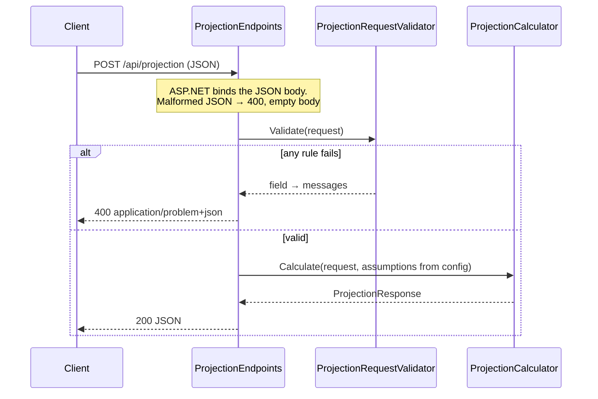

# Super Projector API

An ASP.NET Core minimal API that projects a superannuation balance to
retirement age. Part of [Super Projector](../README.md); the
[web app](../web/README.md) is its only client today.

## Tech stack

| Component | Version | Source |
| --- | --- | --- |
| .NET SDK | 10.0.403 (`rollForward: latestFeature`) | [`global.json`](../global.json) |
| Target framework | `net10.0` (LTS) | both `.csproj` files |
| Microsoft.AspNetCore.OpenApi | 10.0.14 | `SuperProjector.Api.csproj` |
| Scalar.AspNetCore (API reference UI) | 2.19.0 | `SuperProjector.Api.csproj` |
| xUnit / xunit.runner.visualstudio | 2.9.3 / 3.1.4 | `SuperProjector.Api.Tests.csproj` |
| Microsoft.AspNetCore.Mvc.Testing | 10.0.14 | `SuperProjector.Api.Tests.csproj` |
| Microsoft.NET.Test.Sdk / coverlet.collector | 17.14.1 / 6.0.4 | `SuperProjector.Api.Tests.csproj` |

```text
api/
├── SuperProjector.slnx
├── src/SuperProjector.Api/
│   ├── Program.cs                       services, CORS, OpenAPI, /health
│   ├── Endpoints/ProjectionEndpoints.cs POST /api/projection (thin HTTP layer)
│   ├── Domain/                          pure logic: request, response, assumptions,
│   │                                    validator, calculator (no ASP.NET dependencies)
│   ├── appsettings.json
│   └── SuperProjector.Api.http          sample requests
└── tests/SuperProjector.Api.Tests/
    ├── Unit/                            calculator and validator
    └── Integration/                     real HTTP pipeline in memory (WebApplicationFactory)
```

## Run and test locally

```sh
cd api
dotnet run --project src/SuperProjector.Api   # http://localhost:5080, Development environment
dotnet test                                   # 31 tests: 28 unit, 3 integration
```

`SuperProjector.Api.http` has ready-made requests for the VS Code REST Client
extension.

## API documentation

| What | Local URL |
| --- | --- |
| OpenAPI document (JSON) | http://localhost:5080/openapi/v1.json |
| Scalar UI | http://localhost:5080/scalar |

To try a request in Scalar, select **POST /api/projection**, open the test
request panel, edit the JSON body and send it.

Both are **Development only**: `Program.cs` maps them inside
`if (app.Environment.IsDevelopment())`. Azure sets
`ASPNETCORE_ENVIRONMENT=Production`, so they return 404 there. This keeps the
public surface to the two endpoints the app needs.

## Endpoints

| Method | Path | Purpose | Success | Errors |
| --- | --- | --- | --- | --- |
| GET | `/health` | Liveness for App Service and the pipeline | 200 `{"status":"Healthy"}` | None in practice (no checks are registered) |
| POST | `/api/projection` | Calculate a projection | 200 projection JSON | 400 invalid input; 500 unhandled error |

Sample request:

```json
{ "age": 40, "currentBalance": 150000, "annualSalary": 110000, "contributionRatePercent": 12 }
```

Response (200):

```json
{
  "yearsToRetirement": 27,
  "retirementAge": 67,
  "projectedBalance": 1932437.34,
  "totalContributions": 456762.09,
  "totalInvestmentEarnings": 1325675.25,
  "assumptions": { "netReturnPercent": 6.5, "wageGrowthPercent": 3.0, "contributionsTaxPercent": 15, "retirementAge": 67 },
  "disclaimer": "Illustrative only. Not financial advice."
}
```

The calculator loops once per year. Each year it adds that year's contribution
(salary × rate, less contributions tax), applies the net return to the whole
balance, then grows the salary. Money is rounded to cents only in the response.

## Request flow



## Validation and error handling

| Field | Rule |
| --- | --- |
| `age` | 18 to 66 |
| `currentBalance`, `annualSalary` | 0 or more |
| `contributionRatePercent` | 0 to 50 |

The validator collects **every** failed rule, and the endpoint returns them as
a standard validation problem (`application/problem+json`):

```json
{
  "type": "https://tools.ietf.org/html/rfc9110#section-15.5.1",
  "title": "One or more validation errors occurred.",
  "status": 400,
  "errors": {
    "age": ["Age must be between 18 and 66."],
    "contributionRatePercent": ["Contribution rate must be between 0 and 50%."]
  }
}
```

Behaviour observed locally in the Production environment:

- **Malformed JSON, missing body or wrong types** (e.g. `"age": "forty"`) are
  rejected by ASP.NET before our code runs: **400 with an empty body**.
- **Unhandled exceptions** return **500 with an empty body**, because no
  exception-handling middleware is configured. The exception is written to the
  console log (`An unhandled exception was thrown by the application`), which
  App Service captures.
- **Application Insights:** the API has no Application Insights SDK, and the
  Web App has only `APPLICATIONINSIGHTS_CONNECTION_STRING` set. Microsoft's
  [App Service monitoring docs](https://learn.microsoft.com/azure/azure-monitor/app/codeless-app-service)
  list `ApplicationInsightsAgent_EXTENSION_VERSION=~3` as also required on
  Linux, so requests and exceptions may **not** currently reach Application
  Insights (see Known gaps).

## Configuration

| Setting | Default | Meaning |
| --- | --- | --- |
| `Projection:NetReturnPercent` | 6.5 | Yearly return after fees and earnings tax |
| `Projection:WageGrowthPercent` | 3.0 | Yearly salary growth |
| `Projection:ContributionsTaxPercent` | 15 | Tax on each contribution |
| `Projection:RetirementAge` | 67 | Age the projection runs to |
| `Cors:AllowedOrigins` | `["http://localhost:5173"]` | Browser origins allowed to call the API |

The values live in `appsettings.json`. The same defaults are also in code
(`ProjectionAssumptions`, `Program.cs`), so they apply if a setting is missing.

In Azure, override any setting with an **app setting** whose name uses `__`
(double underscore) in place of `:`, and an index for array items:

| appsettings.json key | Azure app setting |
| --- | --- |
| `Projection:NetReturnPercent` | `Projection__NetReturnPercent` |
| `Cors:AllowedOrigins:0` | `Cors__AllowedOrigins__0` (set by Bicep to the Static Web App URL) |

## Health and operations

- **`/health`** uses ASP.NET's built-in health checks with no checks
  registered, so it shows the process is running and nothing more.
- **App Service health check** (`healthCheckPath: /health` in Bicep) pings it
  every minute. On F1 there is a single instance and no scale-out, so an
  unhealthy instance isn't replaced automatically; the check mainly provides
  metrics.
- **Post-deploy smoke test** ([`api.yml`](../.github/workflows/api.yml)):
  retries `/health` for about 2 minutes until it reports `Healthy` (F1 apps
  sleep when idle), then POSTs the sample above and checks for
  `projectedBalance`.

## Known gaps

- **Telemetry may not reach Application Insights.** There's no SDK and no
  `ApplicationInsightsAgent_EXTENSION_VERSION` setting. This hasn't been
  checked in the portal.
- **No exception handler.** 500 and malformed-JSON 400 responses have empty
  bodies, unlike the validation 400.
- **No upper limits on money.** A very large `currentBalance` (e.g. 7.9 × 10²⁸)
  overflows `decimal` and returns 500. This was reproduced locally.
- **Age limit is fixed at 18 to 66** while `RetirementAge` is configurable.
  Lowering the retirement age lets older ages pass validation, and the
  calculator then throws an error (500).
- **Assumptions aren't validated at startup**, so a negative return or a 150%
  tax rate would be accepted.
- **No authentication, rate limiting or API versioning** on a public endpoint.
- **Simplified model:** each year's contribution earns a full year's return,
  which slightly overstates the result. Results are not in today's dollars.
- **Tests:** xUnit v2 (v3 is current), and no code coverage reported in CI
  even though coverlet is installed.
