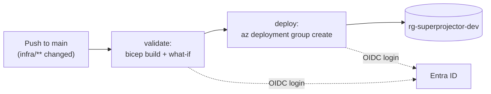

# Super Projector infrastructure and CI/CD

Azure resources for one environment (`dev`), defined in Bicep, plus the three
GitHub Actions pipelines that deploy them and the apps. Part of
[Super Projector](../README.md). Change Azure only through these files, never
by hand in the portal.

## What gets deployed

`main.bicep` deploys into the existing resource group `rg-superprojector-dev`
(australiaeast). `<suffix>` is the first 6 characters of
`uniqueString(resourceGroup().id)`: it's stable for each resource group, and
it's `hk5ho7` in dev.

| Resource | Bicep name pattern | Tier / SKU | Region (dev) | Purpose |
| --- | --- | --- | --- | --- |
| Log Analytics workspace | `log-superprojector-<suffix>` | PerGB2018, 30-day retention | australiasoutheast | Stores Application Insights data |
| Application Insights | `appi-superprojector-<suffix>` | Workspace-based | australiasoutheast | API monitoring |
| Static Web App | `stapp-superprojector-web-<suffix>` | Free | eastasia | Hosts the React app |
| App Service Plan | `asp-superprojector-<suffix>` | F1, Linux | australiasoutheast | Compute for the API |
| Web App | `app-superprojector-api-<suffix>` | On the plan; `DOTNETCORE\|10.0` | australiasoutheast | Runs the .NET API |

Outputs: `apiAppName`, `apiUrl`, `staticWebAppName`, `webUrl` and
`appInsightsName`.

## Parameters and preview

| Parameter | Default in `main.bicep` | dev (`main.bicepparam`) |
| --- | --- | --- |
| `environmentName` | none (required) | `dev` |
| `location` | resource group's region | `australiasoutheast` |
| `appServiceSkuName` | `F1` (allowed: `F1`, `B1`) | default |
| `staticWebAppLocation` | `eastasia` (5 allowed regions) | default |

Preview from the repo root. This deploys nothing:

```sh
az bicep build --file infra/main.bicep
az deployment group what-if --resource-group rg-superprojector-dev \
  --parameters infra/main.bicepparam
```

## Security defaults in Bicep

- `httpsOnly: true` and `minTlsVersion: '1.2'` on the Web App.
- `ftpsState: 'Disabled'`: no FTP deployment.
- `ASPNETCORE_ENVIRONMENT=Production`, which turns off the API's OpenAPI and
  Scalar endpoints.
- CORS allows exactly one origin, the Static Web App's URL.
- No secrets in the template. The App Insights connection string is read from
  the resource at deploy time.
- Every resource is tagged `project=super-projector`, `env=<environmentName>`,
  `managedBy=bicep`.

## CI/CD pipelines



| Workflow | Runs on push to `main` when… | Jobs | Verifies |
| --- | --- | --- | --- |
| [`infra.yml`](../.github/workflows/infra.yml) | `infra/**` or the workflow changes | validate → deploy | Bicep compiles; what-if passes Azure's preflight checks (e.g. quota); outputs listed in the run summary |
| [`api.yml`](../.github/workflows/api.yml) | `api/**`, `global.json` or the workflow changes | build-test → deploy | All .NET tests pass; `/health` reports `Healthy` within about 2 minutes; sample POST returns `projectedBalance` |
| [`web.yml`](../.github/workflows/web.yml) | `web/**` or the workflow changes | build-deploy | Lint and tests pass; site returns HTTP 200 |

- **Triggers:** all three also run manually (**Run workflow**, on `main`), and
  Markdown-only changes (`!**/*.md`) don't trigger them.
- **Shared settings:**
  - jobs are skipped on branches other than `main`;
  - runners are pinned to `ubuntu-24.04`;
  - each workflow has its own concurrency group (`infra-dev`, `api-dev`,
    `web-dev`), so a new run waits instead of cancelling one in progress.
- **Name lookups:** the app pipelines look up resource names with `az`, so run
  `infra.yml` first.

| Action | Version | Used in |
| --- | --- | --- |
| [actions/checkout](https://github.com/actions/checkout) | v7 | all |
| [azure/login](https://github.com/Azure/login) | v3 | all |
| [actions/setup-dotnet](https://github.com/actions/setup-dotnet) | v6 | api |
| [actions/upload-artifact](https://github.com/actions/upload-artifact) | v7 | api |
| [actions/download-artifact](https://github.com/actions/download-artifact) | v8 | api |
| [azure/webapps-deploy](https://github.com/Azure/webapps-deploy) | v3 | api |
| [actions/setup-node](https://github.com/actions/setup-node) | v7 (Node 26 LTS) | web |
| [Azure/static-web-apps-deploy](https://github.com/Azure/static-web-apps-deploy) | v1 | web |

## Identity: OIDC workload identity federation

No Azure password or key is stored in GitHub. Instead:

1. An **Entra ID app registration** has a **federated credential**. It trusts
   GitHub's token issuer (`https://token.actions.githubusercontent.com`) for
   one exact subject, with audience `api://AzureADTokenExchange` (azure/login's
   default).
2. The workflow requests a short-lived GitHub token (`permissions: id-token:
   write`), and `azure/login` swaps it for an Azure access token.
3. The app's service principal has **Contributor on `rg-superprojector-dev`
   only**, not on the subscription.

**Subject format:** new GitHub repositories (created after 15 July 2026)
include the immutable numeric owner and repo IDs. A renamed or recreated repo
with the same name then can't reuse the access:

```text
repo:<owner>@<owner-id>/<repo>@<repo-id>:ref:refs/heads/main
repo:contact2kuldeep@15072567/super-projector@1450214291:ref:refs/heads/main
```

If login fails with `AADSTS700213`, the error message shows the exact subject
GitHub sent; copy it into the credential. The jobs have no GitHub
`environment:`, because that would change the subject's ending to
`:environment:<name>`.

**Repository secrets** (these are IDs, not passwords):

| Secret | Value |
| --- | --- |
| `AZURE_CLIENT_ID` | Application (client) ID of the app registration |
| `AZURE_TENANT_ID` | Directory (tenant) ID |
| `AZURE_SUBSCRIPTION_ID` | Azure subscription ID |

## Known constraints

- **The API and monitoring are in australiasoutheast (Melbourne).** The
  subscription has 0 F1 App Service quota in australiaeast, where deployments
  fail with `SubscriptionIsOverQuotaForSku`. Melbourne keeps data onshore.
  The resource group stays in australiaeast; its region only holds metadata.
- **The Static Web App is in eastasia.** Static Web Apps can only be created
  in a few regions. Content is served from global edge locations, and it hosts
  static files only, with no member data.
- **The F1 tier has no Always On**, so the API sleeps when idle and the first
  request takes about 20 seconds.

## Known gaps

- **No approval gate.** A push to `main` goes from what-if straight to deploy.
- **No CI on pull requests.** Pipelines run only on `main`, so changes are
  first built and tested after they merge.
- **A single environment** (dev), with no deployment slots. Slots aren't
  available on F1.
- **The resource group was created by hand**, outside Bicep.
- **Application Insights auto-instrumentation isn't turned on.** The
  `ApplicationInsightsAgent_EXTENSION_VERSION` setting isn't set (see the
  [API README](../api/README.md#known-gaps)).
- **Basic-auth publishing credentials are still enabled** for SCM and FTP
  (`basicPublishingCredentialsPolicies`). `ftpsState` blocks FTP, but SCM
  basic auth is on.
- **No alerts, no budget alert**, and no diagnostic settings sending App
  Service logs to Log Analytics.
- **The Static Web App deployment token is long-lived.** The web pipeline
  reads it at run time, but it's never rotated.
- **Contributor is broader than needed**; a custom role could be narrower.
- **No security scanning** (dependencies, secrets, code) in any pipeline.
- **Lookups use `[0]`**, so the pipelines assume one Web App and one Static
  Web App in the resource group.

## References

Azure services:
- [Azure App Service overview](https://learn.microsoft.com/azure/app-service/overview)
- [App Service health check](https://learn.microsoft.com/azure/app-service/monitor-instances-health-check)
- [Configure ASP.NET Core apps on App Service](https://learn.microsoft.com/azure/app-service/configure-language-dotnetcore?pivots=platform-linux) (includes the `__` app setting mapping)
- [Monitor Azure App Service](https://learn.microsoft.com/azure/azure-monitor/app/codeless-app-service) (Application Insights settings)
- [What is Azure Static Web Apps?](https://learn.microsoft.com/azure/static-web-apps/overview)
- [Configure Azure Static Web Apps](https://learn.microsoft.com/azure/static-web-apps/configuration)
- [Application Insights overview](https://learn.microsoft.com/azure/azure-monitor/app/app-insights-overview)
- [Log Analytics workspace overview](https://learn.microsoft.com/azure/azure-monitor/logs/log-analytics-workspace-overview)

Bicep:
- [What is Bicep?](https://learn.microsoft.com/azure/azure-resource-manager/bicep/overview)
- [Bicep what-if](https://learn.microsoft.com/azure/azure-resource-manager/bicep/deploy-what-if)
- [Bicep parameters files](https://learn.microsoft.com/azure/azure-resource-manager/bicep/parameter-files)

Identity:
- [Workload identity federation](https://learn.microsoft.com/entra/workload-id/workload-identity-federation)
- [Authenticate to Azure from GitHub Actions by OpenID Connect](https://learn.microsoft.com/azure/developer/github/connect-from-azure-openid-connect)
- [Configuring OpenID Connect in Azure (GitHub)](https://docs.github.com/actions/security-for-github-actions/security-hardening-your-deployments/configuring-openid-connect-in-azure)
- [GitHub OIDC reference](https://docs.github.com/actions/reference/security/oidc) (immutable subject claims)

GitHub Actions:
- [Workflow syntax](https://docs.github.com/actions/writing-workflows/workflow-syntax-for-github-actions) (`paths` filters)
- The action repositories are linked in the table above.
