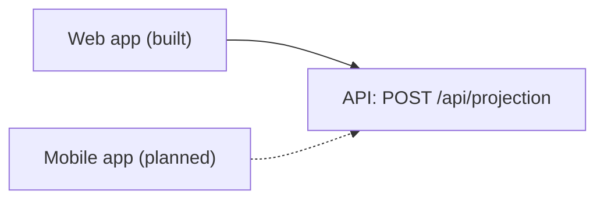

# Super Projector mobile app

> **Status: planned, not built.** This folder only reserves the location.
> There is no mobile code yet.

## Intended approach

- **[React Native](https://reactnative.dev/) with [Expo](https://docs.expo.dev/):**
  TypeScript and React, like the [web app](../web/README.md), so the
  team's skills and some patterns carry over.
- **Same API, same endpoint:** the app would call `POST /api/projection` on
  the existing [API](../api/README.md). The calculation, assumptions and the
  disclaimer ("Illustrative only. Not financial advice.") come from the API, so
  every channel shows the same numbers and wording.

## What the API would need

- **CORS doesn't protect it.** CORS is enforced by browsers only, and native
  apps ignore it. The API is already callable by any client; a mobile app
  makes that obvious. Real protection needs authentication and rate limiting.
- **Member authentication** before any real member data is involved. Today the
  API is anonymous and keeps no data.
- **Versioning or backward compatibility.** Mobile releases reach users slowly,
  so older app versions keep calling the API. Response changes must stay
  compatible, or the API needs versioned routes.
- **Cold starts.** On F1 the first call can take about 20 seconds, so the app
  needs a timeout and a clear loading state.
- **Validation:** the rules would be copied a third time, so a shared source,
  or relying on the API's 400 messages, becomes more attractive.
