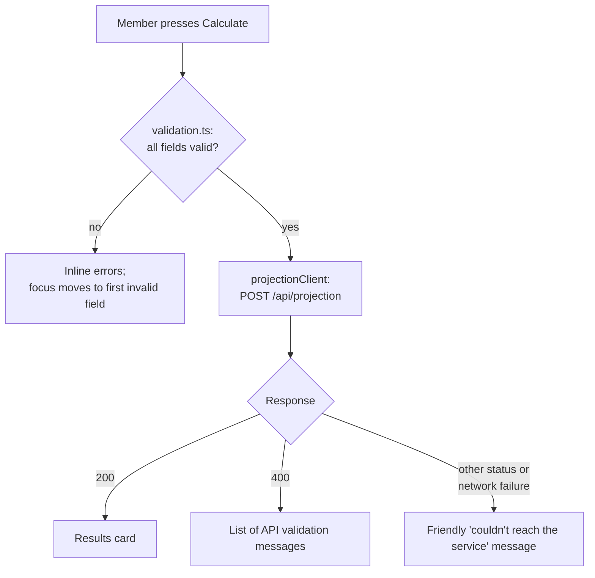

# Super Projector web app

A single-page React app where a member enters their details and sees a
projected super balance at retirement age. It calls the
[API](../api/README.md) and is part of [Super Projector](../README.md).

## Tech stack

Versions installed from `package-lock.json`:

| Tool | Version | Role |
| --- | --- | --- |
| React / React DOM | 19.3.1 | UI |
| TypeScript | 7.0.2 | Types (`tsc -b` runs before every build) |
| Vite | 8.3.6 | Dev server and build (`@vitejs/plugin-react` 6.2.1) |
| Vitest | 5.1.0 | Test runner, with jsdom 31.0.0 |
| Testing Library | react 16.3.3, user-event 14.6.8, jest-dom 7.0.1 | Component tests |
| oxlint | 1.92.0 | Linter (config in `.oxlintrc.json`) |

There is no UI library; styles are in `src/index.css`.

## Run, lint, test and build

The app needs the API running. From the repo root, in two terminals:

```sh
cd api && dotnet run --project src/SuperProjector.Api   # http://localhost:5080
cd web && npm install && npm run dev                    # http://localhost:5173
```

| Command (in `web/`) | What it does |
| --- | --- |
| `npm run dev` | Dev server with hot reload |
| `npm run lint` | oxlint |
| `npm run test` | Vitest in watch mode (`npm run test -- --run` runs once, as CI does) |
| `npm run build` | Type-check, then build into `web/dist/` |

## Connecting to the API

- The base URL comes from **`VITE_API_BASE_URL`**, with no trailing slash.
- **Locally** it is `http://localhost:5080`, from `.env.development`. That file
  is committed because it holds no secrets. To override it on your machine,
  copy `.env.example` to `.env.local` (git-ignored).
- **In Azure**, [`web.yml`](../.github/workflows/web.yml) looks up the API's
  hostname and sets the variable for `npm run build`. Vite **builds the value
  into the JavaScript**, so it's public and changing it needs a rebuild. Never
  put secrets in a `VITE_` variable.
- **CORS:** the browser only lets the app call the API because the API lists
  the site's origin in `Cors:AllowedOrigins`. That's `localhost:5173` locally,
  and the Static Web App URL in Azure, set by Bicep.

## Structure

| File | Role |
| --- | --- |
| `src/api/projectionClient.ts` | Typed `fetch` call and TypeScript types matching the API; returns an outcome and never throws |
| `src/validation.ts` | Client-side rules (same as the API) and string-to-number conversion |
| `src/components/ProjectionForm.tsx` | Four labelled inputs, inline errors, the Calculate button |
| `src/components/ProjectionResult.tsx` | Results card: balance, stats, assumptions, disclaimer (`en-AU` / AUD formatting) |
| `src/App.tsx` | Wires the form to the client and shows the outcome in a live region |
| `public/staticwebapp.config.json` | Static Web Apps routing and headers |

Tests: `src/App.test.tsx` covers 3 UI behaviours, and `src/validation.test.ts`
covers each validation rule and its boundaries (19 tests, 22 in total).

## How a calculation flows



## Error handling

- **Client-side validation** runs first; the API isn't called until every field
  passes. Empty or non-numeric fields get an "Enter your…" message, not a
  silent 0.
- **API 400:** the client flattens the `errors` object into a list. If the body
  is empty (e.g. malformed JSON), it shows a generic "Please check your details"
  message.
- **Network failure** (API down, offline, CORS blocked) **and any other status**
  (e.g. 500) show one friendly message.
- `calculateProjection` **never throws**; it returns
  `success | validation | error`, and `App.tsx` renders each case.

## Accessibility (WCAG 2.2 AA)

Implemented:

- A `<label for>` for every input. The tests find inputs by label text, which
  also checks this.
- `aria-invalid` and `aria-describedby` (pointing at the error text) are set
  only while a field has an error. On submit, focus moves to the first invalid
  field.
- Results and errors appear in an `aria-live="polite"` region that's always on
  the page, so screen readers announce them.
- A 3px `:focus-visible` outline on every focusable element. Native form
  controls only, so the whole page works by keyboard.
- Errors aren't shown by colour alone: there's message text plus a thicker
  border.
- Contrast was computed from the colour tokens: body text 16.9:1, muted text
  7.4:1, error text 5.9:1 or more, button text 7.2:1, input borders 4.1:1 and
  focus ring 6.7:1. All exceed the AA minimums of 4.5:1 for text and 3:1 for
  UI parts.
- The button is at least 44px high. The page uses `lang="en-AU"`, and the
  markup is semantic (`main`, headings, `form`, `dl`).

## Hosting

The site is served by Azure Static Web Apps (Free tier) from a global CDN.
[`web.yml`](../.github/workflows/web.yml) uploads `web/dist` with
`skip_app_build: true`, so Azure deploys the exact build that was tested.
`staticwebapp.config.json`:

| Setting | Value | Why |
| --- | --- | --- |
| `navigationFallback.rewrite` | `/index.html` | Any unknown path loads the app |
| `navigationFallback.exclude` | `/assets/*`, common file types | A missing JS/CSS file returns 404, not HTML |
| `X-Content-Type-Options` | `nosniff` | Browser must trust the declared content type |
| `Referrer-Policy` | `strict-origin-when-cross-origin` | Don't leak full URLs to other sites |
| `X-Frame-Options` | `DENY` | Can't be embedded in a frame (clickjacking) |

## Known gaps

- **No request timeout.** If the API is cold (about 20 seconds on F1), the
  button just shows "Calculating..." with no progress message or cancel.
- **Validation rules are duplicated** in `validation.ts` and the API, with no
  shared source, so they can drift apart.
- **No upper limits on money** (same as the API), so a huge balance reaches the
  API and returns a 500.
- **No Content-Security-Policy or Permissions-Policy header.**
- **Accessibility hasn't been audited.** There's no automated check (e.g.
  axe) and no manual screen-reader test.
- **No end-to-end test** against the real API, and no front-end telemetry.
- **400 messages are shown as a list**, not next to the matching field.
- **Light theme only** (`color-scheme: light`).
- **`type="number"` quirks:** browsers accept `e`, and decimal commas depend on
  the browser's locale.
